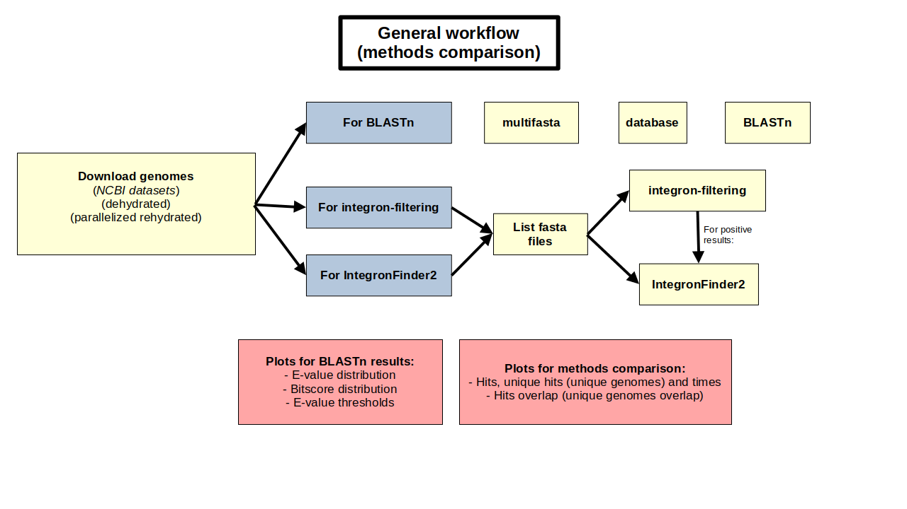
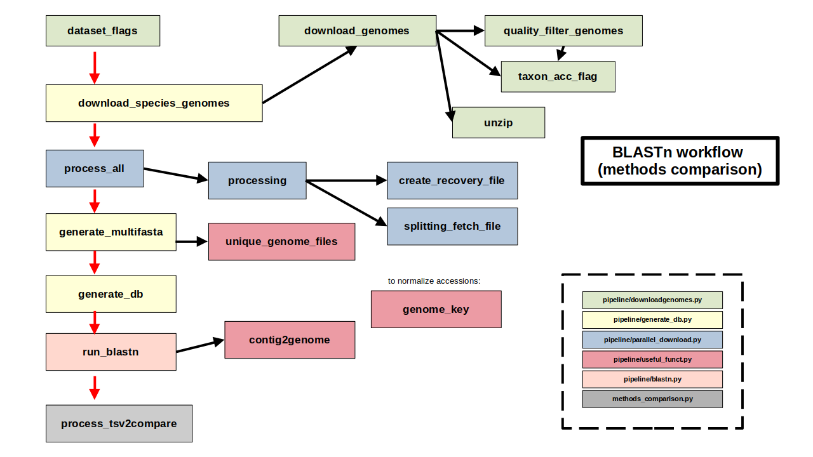
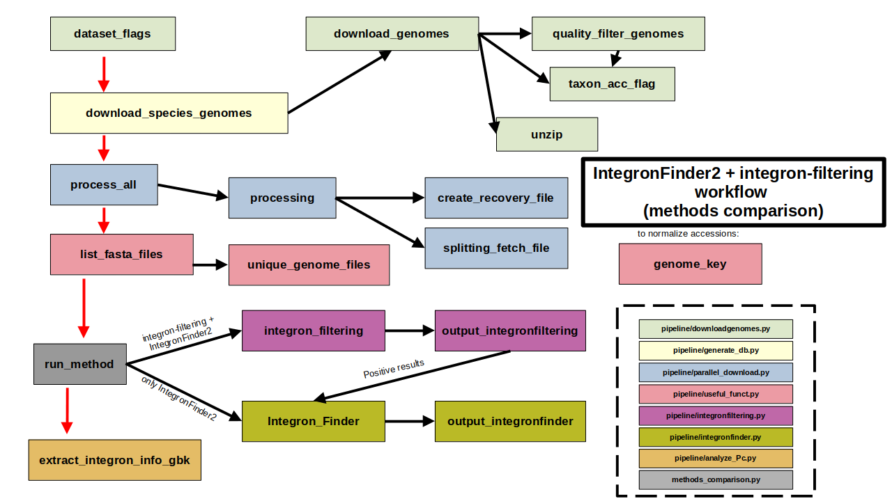
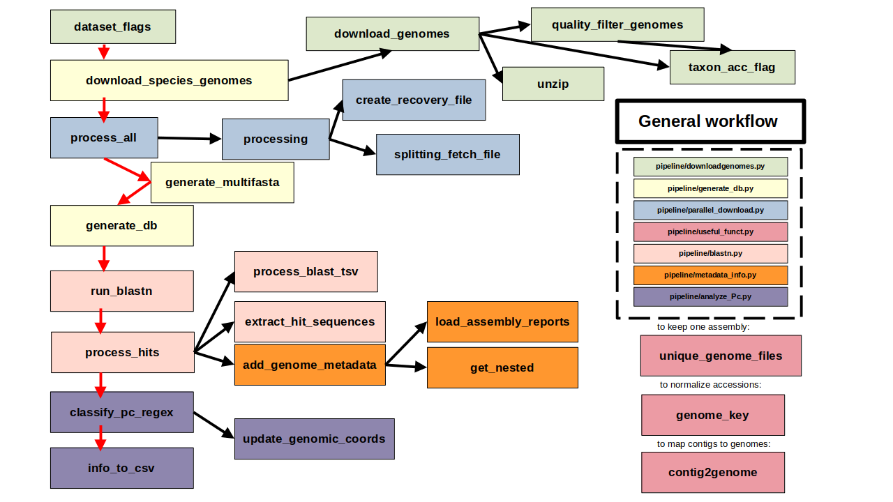

# Development of a bioinformatics pipeline for the classification of class 1 integrons by species and environment.

Bioinformatics pipeline for detecting class 1 integrons and classifying their Pc promoter variants in ESKAPEE Gram-negative bacteria.

The repository is organised in **two main blocks**:

1. [`methods_comparison`](#1-methods_comparison): compares different methods for searching and detecting class 1 integrons.
2. [General pipeline](#2-general-pipeline-pc-classification): runs the end-to-end workflow and classifies Pc variants using BLASTn.

---

## 0. Before starting

###  Installation

The pipeline runs in a conda environment, so you first need a conda distribution (such as [Miniconda](https://docs.conda.io/en/latest/miniconda.html) or [Anaconda](https://www.anaconda.com/download)).

To create the conda environment: 

```bash
# Create the environment from the .yml file included in the repository
conda env create -f environment.yml

# Activate it 
conda activate practicas
```

### Directory structure

Downloaded genomes and generated results are not stored inside the repository. 
They are saved in the parent folder of the repository, in two folders that must exist:

- `data_practicas/`: downloaded genomes and intermediate data.
- `results_practicas/`: results generated by the pipeline.

The only exceptions are the final aggregated CSV files and the generated plots, which are kept in the repository.

> To use different folder names or locations, update the corresponding paths in the code.

### Genome removal

In all cases, genomes with a negative result in the search are deleted to save disk space. 
The same applies to the general multi-FASTA files required by BLASTn.

---

## 1. `methods_comparison`

This block makes it possible to **compare different approaches for the search and detection of integrons** on the same set of genomes. The methods compared are:

| # | Method | Description |
|---|--------|-------------|
| 1 | **BLASTn with *intI1* sequences** | Three variants (see below) |
| 2 | **IntegronFinder2** | Run directly on the genomes |
| 3 | **IntegronFinder2 + `integron-filtering`** | IntegronFinder2 run after a prior filtering step |

The script used is [`methods_comparison.py`](./scripts/methods_comparison.py).

### 1.1 BLASTN variants

[BLASTn](https://github.com/evanpeikon/BLAST) is run using *intI1* reference sequences in three configurations:

- **[Query with a reference Pc](./data/Int1/Int1.fa)**: the query includes *intI1* plus one reference Pc .
- **[Query with a Pc pattern](./data/Int1/Int1_Pc_pattern.fa)**: the query includes a pattern so that any Pc variant is matched.
- **[Query without the Pc part](./data/Int1/Int1_no_Pc.fa)**: the query does not include the Pc region.

The FASTA files were generated with [this script](./scripts/additional/generate_Int1_fasta.py).

### 1.2 `integron-filtering` and its dependency (HattCI)

`integron-filtering` depends on [**HattCI**](https://github.com/maribuon/HattCI). 
It has to be installed manually:

1. **Clone the repository** ([maribuon/HattCI](https://github.com/maribuon/HattCI.git)) inside `scripts/T3_integronfiltering/`.
2. **Compile it with `make`**. This requires a C compiler (`gcc`, already included in the `.yml` environment file) and generates the binary `hattci.out`.

```bash
cd scripts/T3_integronfiltering
git clone https://github.com/maribuon/HattCI.git
cd HattCI
make
```

No further configuration is needed: the script [`scripts/integronfiltering.py`](./scripts/integronfiltering.py) automatically adds the HattCI directory to the `PATH` environment variable, so the binary is found at runtime.

> **Note:** the change to `PATH` only lasts while the script is running, so your system environment is never modified.

### 1.3 General workflow

Overview of how the `methods_comparison` block works:



### 1.4 Internal workflow

Genomes are downloaded in parallel using [NCBI Datasets](https://github.com/ncbi/datasets); the parallelisation happens at the `rehydrate` step.

#### BLASTn

Before running the searches, a BLAST database must be built from the genomes to be screened. 
A minimum hit length is applied (can be modified) so that the BLASTn definition of a hit is as close as possible to the one used by IF2 and `integron-filtering`, which makes the three methods comparable.

The workflow is as follows:



#### IntegronFinder2 + integron-filtering

[IntegronFinder2](https://github.com/gem-pasteur/Integron_Finder) (IF2) detects integrons in bacterial genomes by combining the search for integrase genes (*intI*, using HMM profiles) with the search for *attC* recombination sites (using covariance models). It reports:
- complete integrons (integrase + *attC* sites)
- In0 elements (integrase without *attC* sites)
- CALIN elements (clusters of *attC* sites without an integrase).

The prior filtering step from [integron-filtering](https://github.com/timghaly/integron-filtering) is also used (only [attC-screening.sh](./scripts/pipeline/T3_integronfiltering/attC-screening.sh)). 

For both IF2 and `integron-filtering`, the downloaded genome files must be without creating a database.

The workflow is as follows:



### 1.5 Plotting results

Five final plots are generated.

**BLASTn results** (comparison between the three queries used):

- Boxplot of e-values: `evalue_distribution.png`
- Boxplot of bit scores: `bitscore_distribution.png`
- Number of hits at each e-value threshold: `evalue_thresholds.png`

**Comparison of the three methods**:

- Total hits and unique hits (number of distinct genomes with a hit): `method_comparison.png`
- Overlap between the sets of genomes with at least one hit: `hits_overlap.png`


### 1.6 Analyze results

The definition of a hit differs between methods:

- **IF2**: a hit is any genome where an integron element is detected NOT including CALINs(hit without integrase). 
- **BLASTn**: a hit is any match with *intI1* whose length exceeds a minimum number of base pairs (700 bp by default, the *intI1* sequence is 1014 bp long).

To normalise the results, **unique hits** are also reported (the number of genomes with at least one hit in each method).

To better understand the results, the discordant genomes (those where the methods disagree) can be analysed with [this script](./scripts/additional/analyze_methodscomparison.py), which generates a `.csv` file with the information on the non-matching hits.

---

## 2. General pipeline: Pc integron classification

This block is the general workflow. It performs the **classification of Pc promoter variants using BLAST**.

The general workflow classifies the Pc of the integrons it detects. The initial part is the same as in the previous block: genomes are downloaded in parallel and screened with BLASTn.

For positive genomes, the Pc is analysed and classified into the variants described in the [literature](https://journals.plos.org/plosgenetics/article?id=10.1371/journal.pgen.1000793).

For variants not previously described, the integrase sequence is also extracted, along with any metadata of interest (the selected metadata can be modified).

The workflow is as follows:



### 2.1 Analyze results

The [`analyze_general.py`](./scripts/additional/analyze_general.py) script generates plots and allows the data to be explored.

Results can be grouped by species or by Pc variant, generating plots such as `pc_variants_by_species.png`.

A `.csv` file (`final.csv`) is also produced with detailed information on each hit, including any metadata selected for the analysis.

---

## 3. Integrall database analysis

The data from the [Integrall database](https://bio.tools/integrall) are also analysed with [this script](./scripts/T1_Integrall_Pc_abudance.py), producing [results](./results/Integrall_analysis) on the relative abundance of the ESKAPEE pathogens in this database.


PENDIENTE PRÁCTICAS:

- MEMORIA
- general workflow pipeline diagrama
- ¿documentación?
- pasar el primer workflow de mermaid a libreoffice
- cambair igual la definición de hit de IF2 y quitar lo que sea CALIN